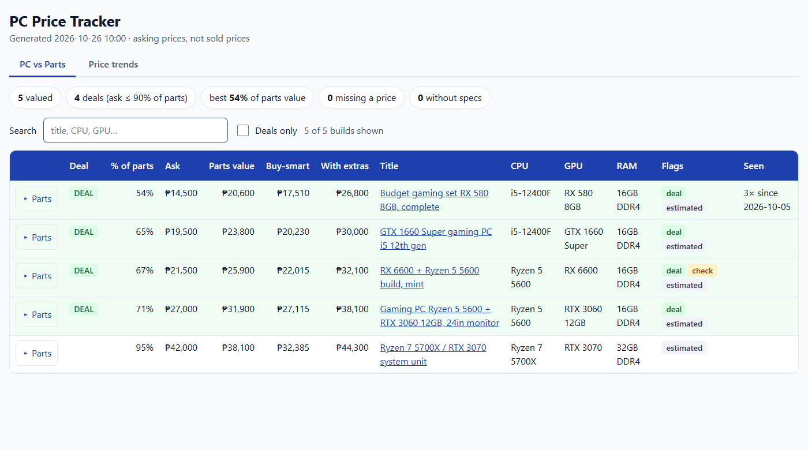
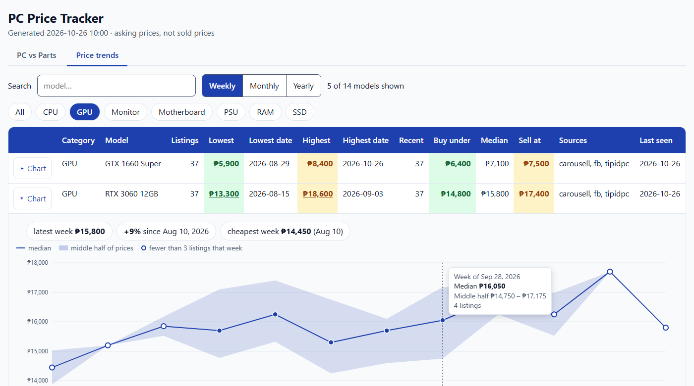
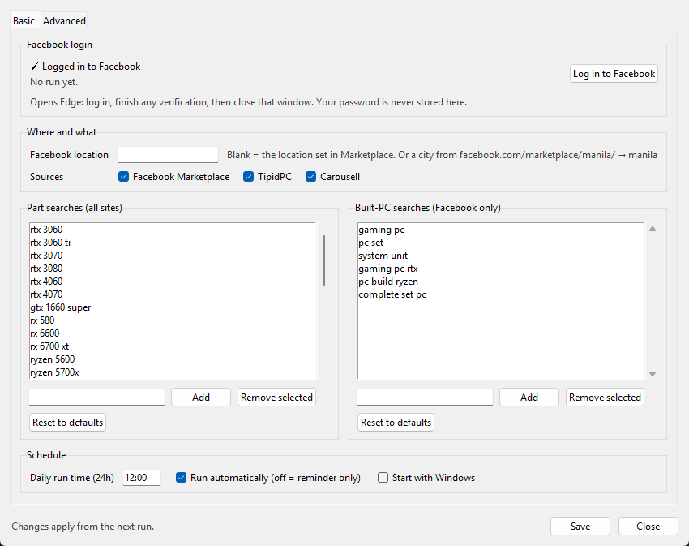

# PC Price Tracker

[](https://github.com/rikked1502/pc-price-tracker/actions/workflows/tests.yml)

Tracks second-hand PC part prices on Philippine marketplaces (Facebook Marketplace, TipidPC, Carousell) and finds
built PCs listed for less than their parts are worth. It runs once a day from the Windows tray and builds an Excel
masterlist plus a one-page HTML report.



<sub>Screenshots use made-up sample data.</sub>

## What it does

- **Price masterlist.** Every listing is classified (GPU, CPU, RAM, SSD, board, PSU, monitor…) and named to a model
  ("RTX 3060 12GB", "Ryzen 5 5600"). Each model gets its lowest and highest price, a buy-under / median / sell-at range
  from recent listings, and a Flips sheet of the widest margins.
- **PC vs Parts.** For built-PC listings it opens the listing once, reads the specs from the description, and prices
  each part from the masterlist. Builds asking 90% or less of their parts value are marked as deals.
- **Price trends.** Weekly, monthly or yearly median price per model, with the middle half of prices shown as a band.
- **Tray app.** A countdown to the daily run, Run now, autorun or reminder-only, and a Settings window for the Facebook
  login, location, sites, search keywords and schedule.



## Setup (Windows)

Needs Windows 10/11, [Python 3.10+](https://www.python.org/downloads/) (tick "Add python.exe to PATH") and Microsoft
Edge (preinstalled on Windows).

1. Download or clone this repo.
2. Double-click **`setup.bat`**. It installs the Python packages, turns on Start with Windows, starts the tray icon
   and opens Settings.
3. In Settings, click **Log in to Facebook**, log in in the Edge window that opens (finish any verification), then
   close that window. Check your keywords, then **Save**.

The tray runs the scrape at the set time each day, or click the tray icon and choose **Run now**. Reports go to
`output/`: `masterlist_<date>.xlsx` and `pc_vs_parts_<date>.html`.



Command line, if you prefer it:

```
python run.py              scrape every source, classify, write the reports
python run.py --no-scrape  rebuild the reports from the data already collected
python run.py --login      open Edge to log in to Facebook
```

## How it works

```
sites.py (TipidPC, Carousell: plain HTTP)  ─┐
fb.py (Facebook: Playwright driving Edge)  ─┴─> data.db (SQLite: listings + every price change)
normalize.py  rules.py (title -> category, model)  specs.py (build description -> CPU, GPU, RAM…)
price.py (masterlist: outlier trim, buy/median/sell)  value.py (build value = sum of part prices)
report.py (Excel)  report_html.py + trends_html.py (HTML report, no network needed to open)
tray.ps1 (schedule)  settings_app.py (tkinter Settings window)  config.py (defaults + settings.json)
```

- Facebook search results are read from the result cards' text, so a part search costs one page load. Each new
  built-PC listing is opened once to read its description.
- Prices are cleaned before they count: placeholder asks (₱1, ₱123, ₱999999) and whole PCs titled by their CPU are
  dropped, then an outlier trim per model removes "for swap" lowballs and typos.
- A named part with too few recent listings uses your price from `manual_prices.csv`. A PSU, case, board or cooler
  the listing doesn't name gets an estimate from `fillins.csv`. The report shows which basis each price used.
- Your settings live in `settings.json` and your data in `data.db`. Both stay on your PC (they are in `.gitignore`),
  as do the Edge profile holding your Facebook login and the reports.

## Tests

```
python -m unittest
```

Parsing, classification, spec extraction, valuation, the reports and the settings rules are covered. CI runs them on
Python 3.10 and 3.13 on Windows.

## Disclaimer

For personal use. Automated access to Facebook is against Facebook's terms and can get an account restricted. The
scraper is slow on purpose (pauses between pages, one browser), but use it at your own risk. Prices are **asking**
prices, not sold prices. Built for the Philippine market: prices in ₱, and sites and model names as sold locally.

## License

[MIT](LICENSE)
